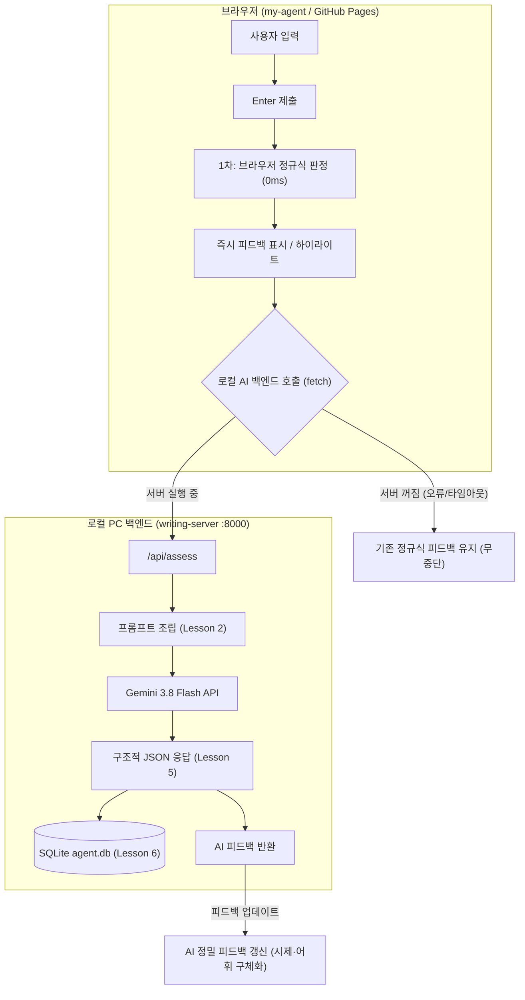
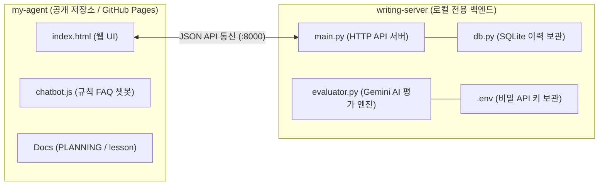
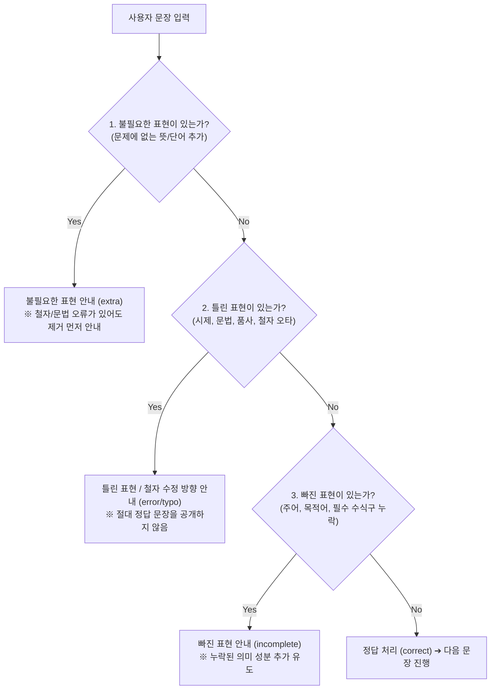
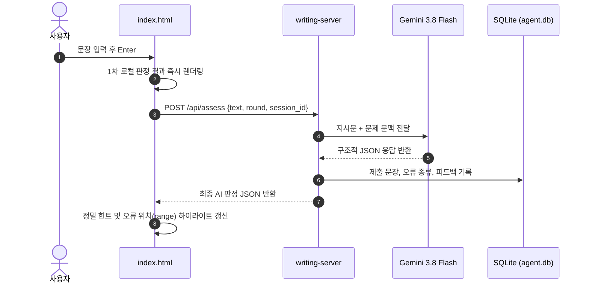

# 서비스 동작 구조 (Architecture)

이 문서는 `typing` 영작 연습 및 안내 서비스의 프론트엔드와 AI 백엔드 간의 전체 동작 흐름, 데이터 처리 원칙, 폴백(Fallback) 구조를 설명합니다.

---

## 1. 전체 아키텍처 다이어그램

---

## 2. 모듈별 역할 및 분리 원칙

* **보안 및 키 분리 (Lesson 2)**:
  * GitHub Pages로 배포되는 `my-agent` 저장소에는 **절대로 API 키나 비밀값을 두지 않습니다.**
  * Gemini API 키는 로컬의 `writing-server/.env`에만 안전하게 보관됩니다.
* **비동기 이중 판정 (하이브리드 & 무중단 폴백)**:
  * 엔터 즉시 브라우저 정규식으로 기본 피드백(또는 정답 패스)을 0초 만에 띄워 사용자 경험을 유지합니다.
  * 로컬 AI 백엔드가 실행 중이면 백그라운드에서 Gemini의 정밀 평가 결과(정확한 시제/어휘 차이 및 하이라이트)를 받아 피드백을 자연스럽게 갱신합니다.
  * 로컬 서버가 꺼져 있거나 타임아웃(1.5초)이 발생해도 에러 창 없이 정규식 피드백이 그대로 유지됩니다.

---

## 3. 영작 평가 순서 및 우선순위 (기획 규칙)

AI 프롬프트와 로컬 판정기는 모두 다음 우선순위 규칙을 엄격하게 준수합니다:

---

## 4. 데이터 저장 및 복습 흐름 (Lesson 6)

* 사용자의 제출 답안과 AI 피드백 내역은 로컬 PC의 `writing-server/data/agent.db`에 영구 보관되어 추후 오답 분석 및 학습 복습에 활용됩니다.
